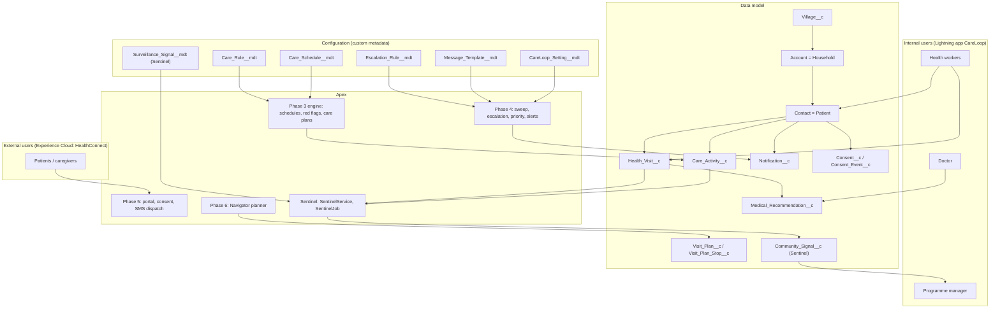
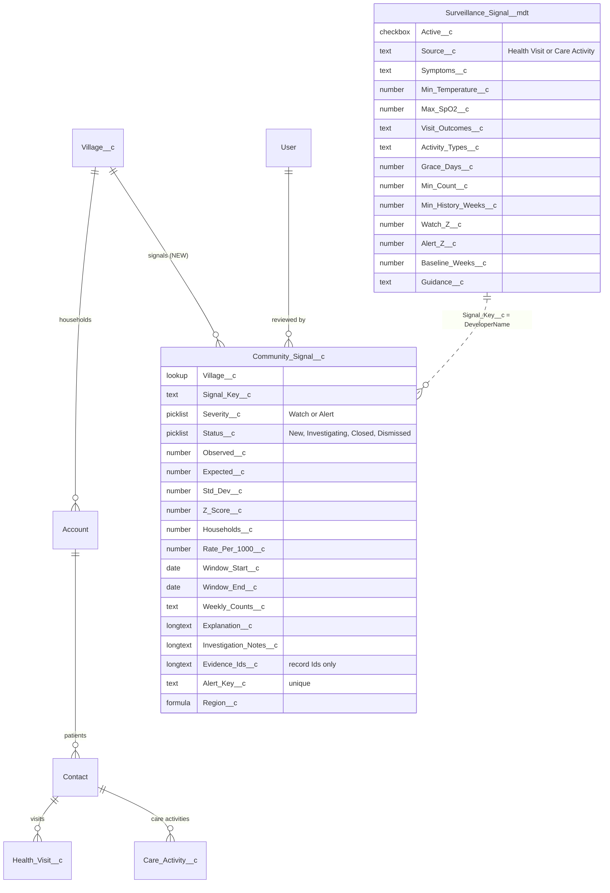
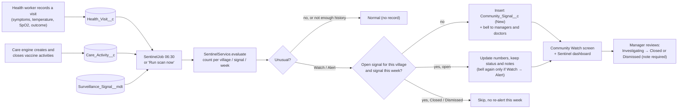
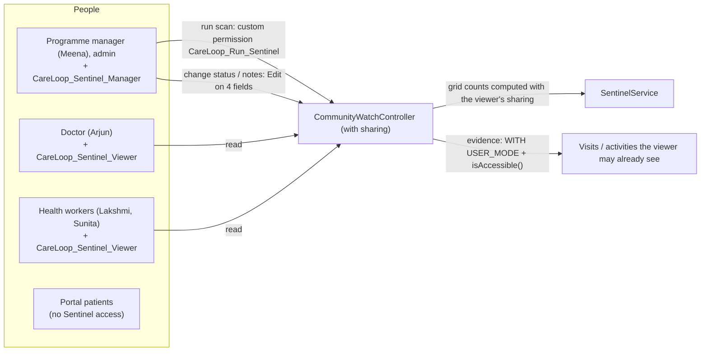
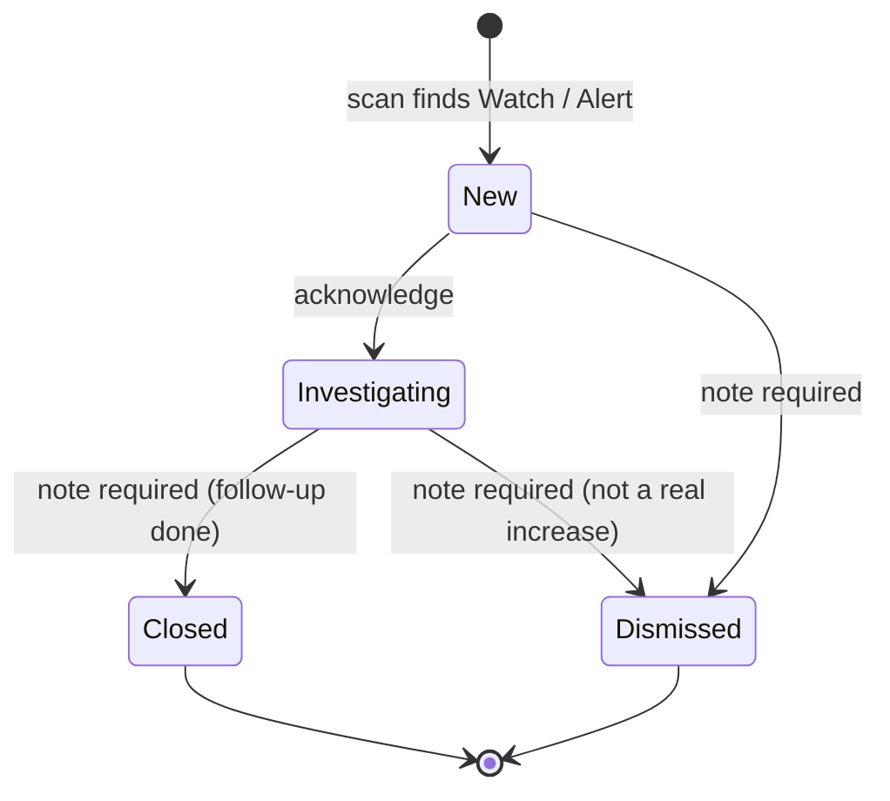

# HealthConnect CareLoop — Solution Architecture (Phases 1–7 + CareLoop Sentinel)

| Label | Meaning |
|---|---|
| **Implemented** | Deployed and verified in the `careloop` org (Phases 1–7, baseline commit `5ef9d6a`) |
| **Integrated, pending verification** | CareLoop Sentinel. The source is in the project, but it counts as implemented only after it is deployed and its tests and verify script pass in the org. Update this line when that happens |
| **Future** | Not built (section 9) |

---

## 1. Business context

Community health workers in Telangana villages (North: Kondapur, Moinabad; South: Shamshabad, Kandukur) care for households with infants, pregnant women and chronic patients. The challenge asks for:
- patient capture by health workers;
- doctor review and recommendations;
- patient self-service and notifications;
- proactive reminders;
- insights into **regional health trends**, outreach effectiveness and care gaps.

| Need | Delivered by | State |
|---|---|---|
| Capture patients and visits | Data model, flows, validation (Ph 1, 7) | Implemented |
| Who needs care, when | Care schedules, activity engine (Ph 3) | Implemented |
| Proactive reminders and escalation | Nightly sweep, escalation ladder, SMS/portal (Ph 4–5) | Implemented |
| Doctor review | Red flags, Doctor Review LWC, live alerts (Ph 3–4) | Implemented |
| Patient self-service and consent | Experience Cloud portal, consent ledger (Ph 5) | Implemented |
| Efficient field work | Navigator daily plans (Ph 6) | Implemented |
| Outreach effectiveness, care gaps | Reports and dashboard (Ph 7) | Implemented |
| **Regional health trends: early warning** | **CareLoop Sentinel** | Integrated, pending verification |

## 2. Component overview

## 3. Phase summary (implemented)

| Phase | Key components |
|---|---|
| 1 | 8 custom objects, 5 custom metadata types (46 records), validation rules, 6 permission sets, tabs, CareLoop app |
| 2 | OWD (Household/Account Private; Patient/Contact, Visits and Activities controlled by parent; Village Read), role hierarchy, users Meena / Arjun / Lakshmi / Sunita, restricted profile *CareLoop Platform Staff*, region sharing |
| 3 | `TriggerHandler` (one trigger per object, bypass), `CareRules`, `CareLoopClock`, `ErrorLogger`, `CareScheduleService`, `CarePlanService`, trigger handlers for Contact, Visit, Recommendation, Activity |
| 4 | `CareSweepBatch`, `PatientPriorityBatch`, `CareLoopNightlyJob` (05:30), `EscalationService`, `PriorityScoringService`, `CareLoopAlertService` + `CareLoop_Alert__e`, Doctor Review and Patient Priority LWCs |
| 5 | `PatientPortalService` / portal LWC, `ConsentService` (hash-chained ledger), `NotificationDispatchQueueable` + `SmsProvider` (Named Credential callout to an echo gateway) |
| 6 | `NavigatorPlanner`, `NavigatorService`, `NavigatorNightlyJob` (06:15), `careNavigator` LWC, `Visit_Plan__c` with measured improvement vs a due-date list |
| 7 | Screen flows (Register Patient, Request Closure), record-triggered flow, approval process for closures, 8 reports, dynamic dashboard *CareLoop Programme Intelligence* |

---

## 4. CareLoop Sentinel (integrated, pending verification)

### 4.1 Purpose
Phases 1–7 look at **one patient** at a time. Sentinel looks at **each village as a whole** and asks one question every morning: *is this week unusual compared with this village's own recent weeks?* It is an early-warning and decision-support tool. **It never diagnoses a disease and never declares an outbreak.** People investigate and decide.

### 4.2 Data model and relationships

**Signal definitions shipped** (custom metadata records, editable in Setup):

| Signal | Counts | Min count | Notes |
|---|---|---|---|
| Fever cluster | Visits with symptom *Fever* **or** temperature ≥ 38.0 °C | 3 | |
| Respiratory illness cluster | Visits with *Cough* or *Breathlessness* **or** SpO2 < 94 | 3 | |
| Households not reachable | Visits ending *Patient Not Available* or *Patient Refused* | 4 | Access problem, not illness |
| Vaccine doses delayed | Immunisation activities not completed within 7 days of the due date | 3 | Window ends 7 days ago (grace); cancelled doses excluded; early sign of zero-dose and drop-out children |

Shared settings: Watch at z ≥ 2, Alert at z ≥ 3, baseline 4 weeks, history needed in at least 2 of those weeks.

### 4.3 End-to-end data flow

### 4.4 Detection logic and thresholds

For every active village (V) and every active signal (S), on day *asOf*:

1. **This week:** count matching events in the 7 days ending *asOf*. Vaccine signals use the 7 days ending *asOf − 7* (the grace period).
2. **Baseline:** count the same thing in each of the 4 weeks before (weeks 1–4).
3. **History check:** count the baseline weeks in which the village has **any** recorded visit (for vaccine signals, any immunisation activity). If fewer than 2, the result is **Not assessed**. A village with no data is not a village with zero cases.
4. `expected = average of the 4 weeks` and `spread = max(standard deviation, 1)`.
5. `z = (this week − expected) / spread`.
6. **Alert** if this week ≥ the minimum count and z ≥ 3. **Watch** if this week ≥ the minimum count and z ≥ 2. Otherwise **Normal**.

| Safeguard | Example it prevents |
|---|---|
| Minimum count | 0 → 2 fever visits (z = 2) stays Normal |
| Spread floor of 1 | A flat 0,0,0,0 history would otherwise make 1 case "infinitely" unusual |
| Own-village baseline | A large village is not always worse than a small one |
| History check | A new village, or one where nobody recorded visits, is not flagged |
| Noisy villages need bigger jumps | History 0,10,0,10 has spread 5.8, so 12 is still Normal |
| Grace period for vaccines | A dose one day late is not a delay |
| Watch before Alert | An early, softer level |
| Duplicate prevention | One record per village, signal and window; re-scans update it |
| Closed / Dismissed respected | A reviewed signal is not raised again for the same window |
| Human review | The system never declares anything on its own |

**Worked example:** Moinabad had 1, 0, 1, 1 fever visits in the last four weeks, so expected = 0.75 and spread = max(0.5, 1) = 1. This week has 7 fever visits from 5 households, so z = (7 − 0.75) / 1 = 6.25. That is an **Alert**, and the explanation shown is written in these words. (Real demo numbers differ because the background data is random.)

The approach follows the idea of the CDC's EARS aberration-detection methods and India's IDSP weekly syndromic surveillance. It is *EARS-style*: simplified and not a certified implementation.

### 4.5 Security and access control

| Concern | Control |
|---|---|
| Region-based record access | Sentinel classes are `with sharing`. The grid is counted only from records the viewer can see; the 06:30 job runs as the admin who scheduled it, so it sees every village |
| Field and object security | Evidence and review queries use `WITH USER_MODE`; update uses `AccessLevel.USER_MODE` |
| Who can act | Scan: custom permission (Manager only). Status and notes: Edit on `Community_Signal__c` (Manager only). Viewers: read only |
| Aggregate privacy | `Community_Signal__c` holds counts, village names and record Ids, never names or vitals. Reports and dashboard show only these aggregates. OWD Public Read Only by design (a village-level count is not patient data) |
| Patient-level drill-down | Only through the Community Watch evidence list, and only the records the viewer is already allowed to open |
| Consent | Sentinel sends no patient messages, so the Phase 5 consent ledger is not involved |
| Clinical claims | Labels say "unusual increase for investigation"; the statuses deliberately do not include "Confirmed"; the UI shows a disclaimer |
| Existing permission sets | Not modified. Two new permission sets are layered on top |

### 4.6 Review workflow

Every change appends `[date time user -> status] note` to `Investigation_Notes__c`. The controller enforces two rules: the status must be one of the four values, and Closed or Dismissed need a note.

### 4.7 Sentinel components

| Type | Name | Purpose |
|---|---|---|
| Custom metadata type | `Surveillance_Signal__mdt` + 4 records | Signal definitions and thresholds |
| Custom object | `Community_Signal__c` (24 fields, *All* list view) | Recorded Watch and Alert signals and their review |
| Apex | `SentinelService` | `evaluate()` builds the grid (read only); `scan()` records and notifies |
| Apex | `SentinelJob` | Daily 06:30 schedule (idempotent) |
| Apex | `CommunityWatchController` | LWC API: overview, scan, status, evidence |
| Apex tests | `SentinelServiceTest` (11), `CommunityWatchControllerTest` (3) | 14 test methods |
| LWC | `communityWatch` on the *Community Watch* app page and tab | Village × signal grid, signal cards with weekly bars, review panel |
| Reports and dashboard | 3 reports + *CareLoop Sentinel – Community Early Warning* (dynamic) | Aggregates by region, type and village |
| Security | `CareLoop_Sentinel_Manager`, `CareLoop_Sentinel_Viewer`, custom permission `CareLoop_Run_Sentinel` | Access |
| Modified | `CareLoop.app-meta.xml` | +2 tabs |

### 4.8 Reuse of existing services

`CareLoopClock.today()` (the same demo clock), `CareLoopAlertService.notify()` and `doctors()` (bells), `ErrorLogger` (job failures), `CareRules.STATUS_CANCELLED`, the report folder `CareLoop_Reports` and the dashboard folder `CareLoop_Dashboards`. No existing class is changed.

## 5. Scheduled processing

```mermaid
gantt
    title Daily automation (org time)
    dateFormat HH:mm
    axisFormat %H:%M
    section Phase 4
    Care sweep + priority :05:30, 30m
    section Phase 6
    Navigator plans :06:15, 15m
    section Sentinel
    Community scan :06:30, 10m
```

## 6. Integration

| Integration | Mechanism | State |
|---|---|---|
| SMS | Named Credential `CareLoop_SMS` → echo gateway (no real SMS) | Implemented (Phase 5) |
| Live doctor alerts | Platform event `CareLoop_Alert__e` + bells | Implemented (Phase 4) |
| Sentinel | **None external.** Bells only, through the custom notification type `CareLoop_Alert` | Integrated |

## 7. Testing strategy

| Level | Phases 1–7 | Sentinel |
|---|---|---|
| Apex tests | 123 tests, 89% coverage | +14 test methods (target ≥ 85% on new classes) |
| Verification scripts | 7 scripts (`run-all-verifications.ps1`) | `innovation-verify.apex`, 10 checks, rolled back |
| UAT | Login-As per persona | Persona matrix in the Sentinel Test Plan |

## 8. Design decisions

| Decision | Reason |
|---|---|
| Rules in custom metadata | Deployable configuration; no code change to tune |
| One trigger per object + handler bypass | Predictable order; tests can isolate |
| Transparent statistics, no ML | Explainable to workers and judges; no training data exists; no data leaves the org |
| Count the viewer's own records in the grid | Region privacy stays intact without a second security model |
| Store signals, not daily snapshots | A signal needs status, notes and a reviewer; avoids millions of rows |
| Schedulable (not Batch) for Sentinel | Village count is small; Batch Apex is the documented scale path |

## 9. Future (not implemented)

See `HealthConnect_CareLoop_Limitations_and_Roadmap.md`. The main items:
- feed open Sentinel signals into Navigator priority;
- per-region notification routing;
- a district roll-out using Batch Apex;
- threshold tuning on real history;
- randomised reminder experiments.
